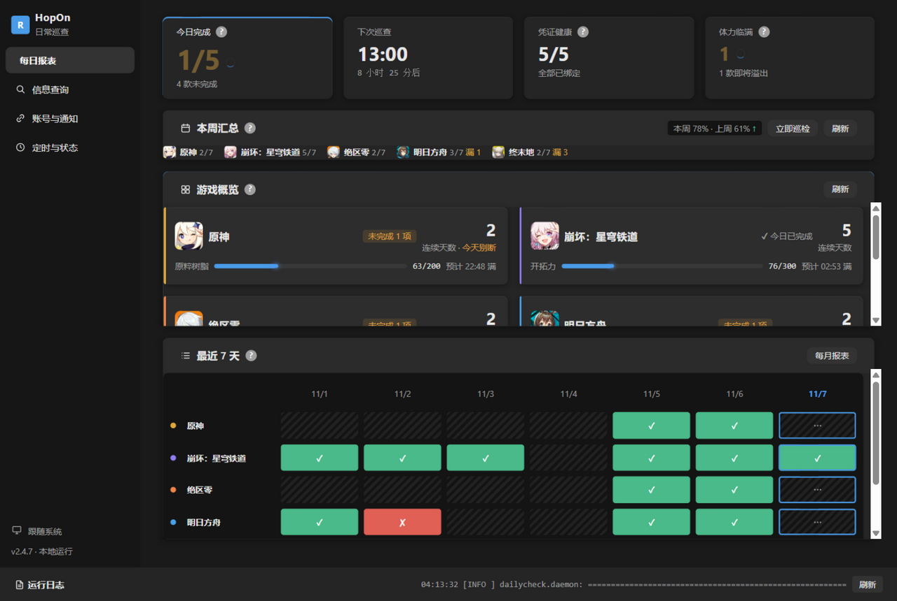
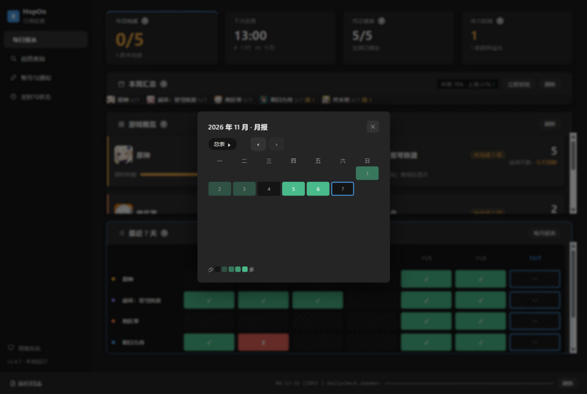
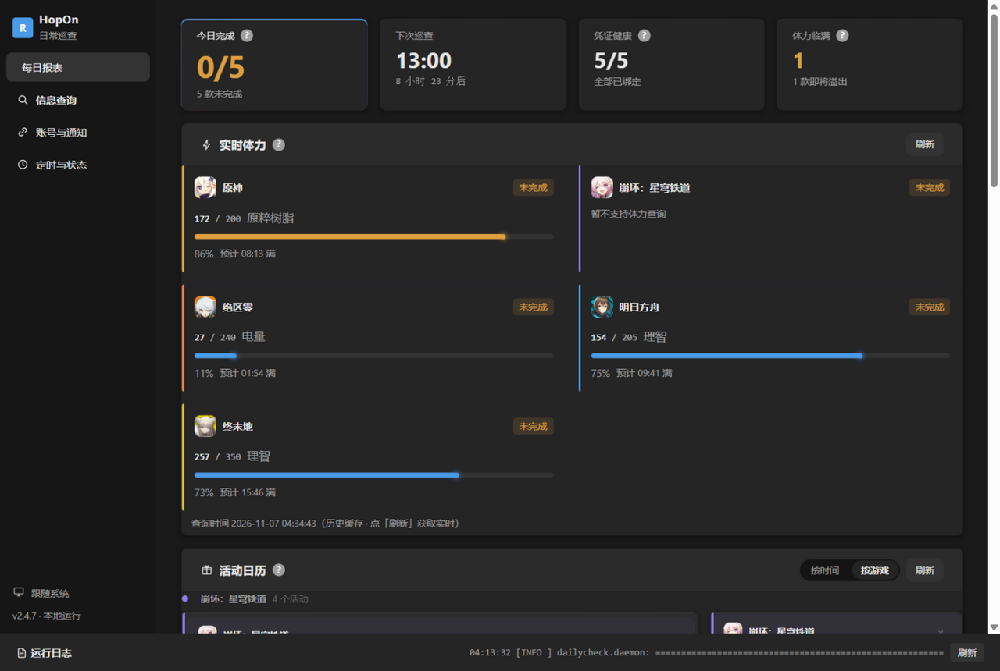
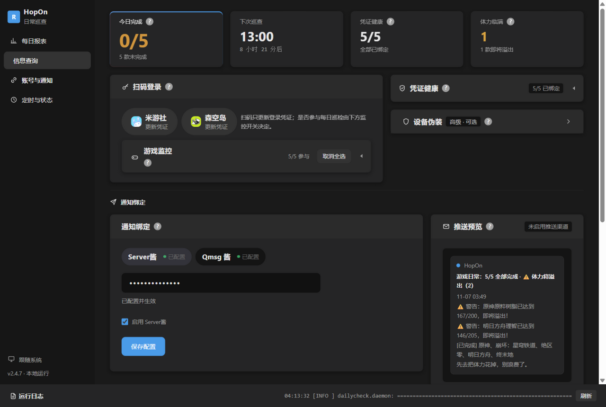

# HopOn · 日常巡查

  
  
  
  

> **HopOn（日常巡查）**：名字取自「该上号了」——游戏玩家每天最熟悉的那句召唤，
> 也是这个软件的灵魂动作：到点提醒你该上号处理日常了，查完就走。

只做「查询 → 判断 → 提醒」三件事：**不代打、不碰游戏客户端、不修改任何游戏内数据**。

> 最新版本 **v2.6.1** → [下载](https://github.com/QianYiXi0723/HopOn/releases/latest) ｜ 功能总览见下

内置常驻守护进程 + 系统托盘，**不需要 Windows 任务计划**；所有配置都在网页控制台里完成。

---

## 📸 界面预览

| 每日报表（月报热力 + 三态格） | 月报弹窗（深浅 = 当天完成游戏数） |
|---|---|
|  |  |
| **实时体力 + 活动日历** | **账号绑定 + 推送预览** |
|  |  |

## ✨ 功能总览

**巡查与提醒**
- 多游戏日常提醒：原神 / 崩坏：星穹铁道 / 绝区零（米游社）+ 明日方舟 / 终末地（森空岛）——新游戏按数据源接入即可扩展
- 体力回满即推、活动结束提醒（提前天数可设，1–30 天）、每周日周报
- 免打扰时段 / 完成也推送，推送节奏完全可配

**报表与回顾**
- 月报下钻：整月热力日历（深浅 = 当天完成游戏数）+ 分游戏逐日明细
- 周完成率、连续天数、最近 7 天三态报表（未检查 / 失败 / 无数据）
- 页内 toast：守护进程的推送同步弹在打开的控制台里

**安全与可靠**
- 凭证安全：登录态与推送密钥 Windows DPAPI 加密落盘
- 数据外置：全在 `%LOCALAPPDATA%\HopOn`，重装卸载不丢 + 历史每日滚动备份
- 三重落盘时刻：定时班 + 凌晨 03:50 日界班 + 关机前自动巡检，「做了就记上」

**形态**
- 桌面壳（C# + WebView2）+ 便携 Python 引擎，双击即用；控制台也能浏览器开
- 安装器 / 绿色版双发行形态；应用内检查更新
- 手机推送：Server酱（微信）/ Qmsg（QQ）双渠道长期实测；Bark / 飞书 / 钉钉
  发送引擎已内置、配置界面待做（见开发者文档待办）

## 🚀 最新版本 v2.6.1

- **体力三态真实值**：未满 `157/200`、满 `200/200`、道具突破上限 `312/240` 原样显示，
  悬浮提示区分「已满」与「超出上限 N」
- **星铁备用开拓力**：补抓显示「205/300 + 备用 298」（此前漏抓）
- **推送预警**：超出上限时「已超出上限 312/240（超出 72 点）！」
- **月报下钻**（v2.4.4~2.4.6 迭代）：整月热力日历 + 分游戏抽屉，‹ › 翻历史月份
- **关机前落盘**（v2.4.3+）：彻底退出 / 系统关机前自动静默巡检，「做了却显示没做」根治
- **安装器 + 检查更新**（v2.4.1+）：Setup.exe per-user 安装；应用内联网检查新版本

## 📥 下载

到 [Releases](https://github.com/QianYiXi0723/HopOn/releases/latest) 下载：
- `HopOn_v2.6.1_Setup.exe` —— 安装器版（推荐，per-user 无需管理员）
- `HopOn_v2.6.1_Windows_x64.zip` —— 绿色版（解压即用）
- `SHA256SUMS.txt` —— 校验和清单：下载后核对文件完整性用（`certutil -hashfile 文件名 SHA256` 比对），不需要它的话可忽略
- 找历史版本 / 逐版更新说明 → [全部 Releases](https://github.com/QianYiXi0723/HopOn/releases)
- 🇨🇳 **国内免梯下载** → [Gitee 镜像](https://gitee.com/qianyixi/HopOn/releases)（与 GitHub 同步发版）

首次打开是演示模式，按页面引导扫码绑定账号、配好推送即完成。**只读查询**：
不签到、不代打、不修改任何游戏数据，账号零风险。

## 💬 官方交流群

QQ 群 **1135683779** —— 反馈问题、提需求、交流玩法。
（以本项目 [Releases 页](https://github.com/QianYiXi0723/HopOn/releases) 公布的群号为准，谨防冒名。）

---

## 📜 更新日志（历史版本）

<b>展开查看 v1.1.0 ~ v2.1.2 的历史更新记录</b>

### v2.1.2

- **修复全新机器首次运行必崩**：没有 `device_identity.json` 时（也就是任何新用户第一次
  解压运行），`core/mihoyo_api.py` 的模块级初始化会调用定义在文件后方的 `_IDENTITY_LOCK`
  与 `_generate_id`，直接抛 `NameError`，导致 `/api/device` 空响应，扫码、查询、巡检一起失效。
  已把两处定义上移到初始化之前，并在原位置留下位置说明防止被搬回去。
  **v2.1.1 的包里就是这份坏代码，请换成本版。**
- **发行形态改为多文件**：去掉 ILRepack 合并。net48 没有官方单文件发布，手搓合并在
  `/internalize` 下会把 WebView2 类型降为 internal → `TypeLoadException`（v2.0.0/v2.1 的病根）。
  实测合并只省 10,888 字节和两个文件，而 `WebView2Loader.dll` 本来就是原生件、合不进去，
  「单文件」一直是假象。现在根目录是 exe + 3 个 dll，与 BetterGI、绘世启动器等成熟项目一致。
- **新增构建门禁**：`shell/build.ps1` 每次构建都会把四件 + engine（剥掉 `logs/`）复制到
  `%TEMP%` 空目录实跑，断言窗口标题、`/api/env`、`/api/device`、首启自动生成身份文件、
  页面 DOM 已渲染、页面内 `fetch('/api/*')` 真的走通。
  上面两个 bug 都只在「无历史产物、无身份文件」的全新目录复现，旧冒烟永远绿。
- **页面不再依赖本地 HTTP 服务**：壳接管 `https://hopon.local/*`，`index.html`、
  `app.js`、`style.css`、图标全部从 `engine\ui` 与 `engine\static` 直接读盘；
  页面发出的 `/api/*` 由壳转发到引擎端口（显式 `Proxy = null` 绕过系统代理）。
  窗口出现得比引擎更早，也不再受端口与代理影响。浏览器/`app.py` 路径仍走原来的 HTTP 服务。

### v2.1.1

- **修复发行版双击打不开**：v2.0.0 / v2.1 的 exe 启动后进程立刻退出，窗口根本不出现
  （Windows 事件日志里是 `System.TypeLoadException`）。原因是壳在单文件化合并时把
  WebView2 的类型降成了 internal，主窗口构造时类型加载失败。现已改为保留类型可见性的
  合并方式，exe 体积不变（653,824 字节）。**如果下载过 v2.0.0 或 v2.1，请换成这个版本。**
- 壳的构建流程固化成 `shell/build.ps1`（dotnet publish + ILRepack + 冒烟），
  不再靠手工敲命令；脚本里写明了为什么不能加 `/internalize`。

### v2.0.0

- **Windows 桌面壳**：C# WinForms + WebView2 外壳 + 便携 Python 引擎，
  以单文件 exe 形态发行；托盘负责「彻底退出」并连带收尾后台引擎进程，
  开机自启登记进系统启动项。
- **演示模式引导**：未配置数据源时不显示编造数据，而是引导去扫码；
  配置齐全后才展示真实信息。
- **定时任务与状态页重构**：改为三卡布局；守护进程状态折进状态卡的状态条，
  巡检结果改为三列时间轴。

### v2.1

- **开机自启自动巡检**：过去开机自启后守护进程不会自动拉起，定时提醒会静默断线；
  现在桌面壳在引擎就绪后自动拉起，拉起失败时用托盘气泡提示。
- **凭证失效告警**：某账号连续两次鉴权失败时单独推一条提醒（同一账号 24 小时内
  只提醒一次），不再混在日常「查询失败」里被忽略。
- **推送回压**：某个通道连续 5 次发送失败后自动静默 6 小时，避免手机被失败消息刷屏；
  静默期间仍照常本地记录，恢复后自动解除。
- **托盘「立即巡检」**：托盘右键可直接触发一次检查，不必等定时点。
- **查询代理**：账号绑定页可为米游社查询单独指定出口代理（留空即直连），
  用于换网络环境排查风控。
- **控制台细节**：最近推送改为等高的可展开格子；活动日历游戏名与图标垂直居中；
  F5 刷新后整页闪一下作为反馈。

### v1.2.0

- **控制台 UI 全面重构**：满幅 12 列 Bento 网格、KPI 摘要条、游戏概览迷你卡、
  GitHub 式热力图、紧迫感系统（data-urgency）、双主题、通知绑定三区工作流。
- **并行查询提速**：collect_statuses 改线程池并发，5 款游戏 16~17 秒 → 约 4~5 秒；
  设备指纹获取加锁（防风控回归）。
- **推送历史结构化**：新增 data/push_history.json，「最近推送」不再解析日志。
- **config.json 滚动备份**：写入前自动备份 .bak-1/.bak-2/.bak-3。
- **前端源码拆分**：HTML/CSS/JS 独立成 ui/ 三件套，启动时装配。

### v1.1.8

- **原神图标换回经典版**：之前那张左上角有「6th」周年角标。实测 App Store 国区、
  国际区、TapTap、B站官方号、官网 favicon **全都是同一张 6 周年图**，
  只有本机米哈游启动器的 `ico/hk4e_cn.ico` 还是经典版 —— 改成从那里取，
  裁掉底部 miHoYo 名称条后导出（256 → 228）。
- `tools/fetch_game_icons.py` 重写：优先本机启动器 ico，没有再退回 App Store，
  并在输出里标明每张图的来源与是否带角标。

### v1.1.7

- **修「换了图标还显示旧图」**：图标 URL 带上 `?v=<文件 mtime>`，换图后 URL 必变；
  静态资源的 `Cache-Control` 从 `max-age=86400` 改成 `no-store`。
  WebView2 的磁盘缓存再顽固也绕不过去。
- 侧栏版本号升到 v1.1.7 —— 页面左上角看到的版本就是这个，
  如果重启后还是 v1.1.6，说明程序没真的重启。

### v1.1.6

- **活动列表只留抽卡资源**：原神只认「原石」、星铁只认「星琼」、绝区零看
  `monochrome_cnt`（菲林池）、方舟正文含「合成玉/源石」才留。
  奖励字段拿不到时默认保留并标注「奖励未公开」（`KEEP_WHEN_REWARD_UNKNOWN`）。
- **两段分组 + 精确排序**：`进行中`按结束时间升序、`未开启`按开启时间升序，
  已结束直接过滤，缺时间的排所在组末尾。
- **左侧换成官方头像**：按 `game_id` 固定渲染派蒙 / 三月七 / 邦布 / 阿米娅，
  36×36、8px 圆角、轻阴影；图来自 App Store 官方商品图，
  `py tools/fetch_game_icons.py` 可重新下载，新增 `/static/` 静态路由（只吐图片，挡目录穿越）。
- 活动行改版：图标 + 标题 + 「游戏名 · 倒计时 · 进度」+ 奖励标签 + `×`，
  72 小时内倒计时变橙加粗。

### v1.1.5

- **活动数据换成米游社「活动日历」**：不再抓公告。原神 `act_calendar`、星铁
  `get_act_calender`（官方把 calendar 拼错了）、绝区零 `activity_calendar`
  （参数是 `uid`/`region`），拿到的就是 App 里那份：活动名、起止时间、
  进度（36/36、0/900）、状态（未开启 / 进行中 / 已完成）。
- **删掉就是删掉**：每行的「提醒」开关换成 `×`，点完立刻消失，ID 写进
  `data/ignored_activities.json`，之后无论刷新还是推送都不会再出现；
  底部有「恢复全部」兜底。原来的 `MUTED_KEYWORDS` / `alert_enabled` 整套逻辑已删除。
- **排版向手机端靠**：行内是「图标 + 名称 + ⏱ 倒计时 + 进度 + 状态标签」，
  倒计时按「剩 5 天 9 小时 / 2 小时 / X 天后开启」显示，72 小时内会变成橙色。
- 终末地仍不支持（官方没有带绝对日期的活动数据）。

### v1.1.4

- **活动提醒扩到四款游戏**：星铁、绝区零、明日方舟都接上了官方数据源，加上原神一共
  27 条进行中的活动 / 公告，全部带真实起止时间，照样走 ≤72 小时倒计时。
  - **崩坏：星穹铁道**：`hkrpg-ann-api` 的 `getAnnList`（国服 `type_list` 只有「公告」），
    版本说明、无名勋礼、限时玩法都在这一组里；周边 / 问卷 / 防沉迷按标题排除。
  - **绝区零**：域名必须是 `api-takumi.mihoyo.com`（`ann-api` 一直 `retcode=-1000`），
    按 `tag_label` 取「活动公告」「福利活动」。
  - **明日方舟**：鹰角官网 `api/news` 的 `tab=1` 是活动，结束时间只写在详情正文
    「活动时间：10月24日20:00~11月24日03:59」里，按发布时间补年份后正则解析。
  - **终末地**仍标「暂不支持」：官网公告只写「版本更新后至版本维护前」，没有可计算的截止日期。
- **活动列表不再截断**：改成全量展示（原来只取结束最早的 12 条，接上四款游戏后
  正好会把绝区零、方舟整个藏掉），末尾提示共多少个。
- 抓取失败按游戏隔离：哪款接口挂了只丢那一款，其余照常更新缓存。

### v1.1.3

- **单条活动可静音**：「信息查询」页的每条活动右侧多了「提醒」开关，可以单独决定
  这条活动要不要参与 72 小时倒计时推送。关掉只是**不推送**，列表里照常展示并标注
  「已静音」；点开又能恢复，**不用改代码也不用重启守护进程**。
- **默认静音四类常驻公告**：标题命中 `祈愿` / `砺行修远` / `祝圣移涌` / `幽境危战`
  的活动默认关闭提醒 —— 卡池和刷素材类公告天天催只会让人对提醒脱敏。
- **刷新不覆盖你的选择**：`data/activities.json` 里每条活动多了 `alert_enabled` 字段，
  每天重新拉取时按活动 ID（`ann_id`）继承上次的手动设置；只有真正的新活动才按
  关键词取默认值（普通活动默认开、命中关键词默认关）。
- 新增 `POST /api/activities/toggle`（活动 ID + 目标状态），写入走独立并发锁 +
  `mkstemp` 原子替换，连点多个开关不会互相覆盖。

### v1.1.2

- **左侧导航栏**：五个页签从顶部横排改成左侧 Sidebar，内容区在右侧；
  窄屏（<820px）自动折回顶部横向导航。
- **新增「信息查询」页**：实时体力看板（原神树脂 / 星铁开拓力 / 绝区零电量 /
  方舟·终末地理智，点刷新即时查询，不写历史、不推送）+「即将结束的活动」列表。
- **活动结束提醒**：原神官方公告接口能拿到**真实起止时间**；活动缓存
  `data/activities.json` 每 20 小时最多拉一次；剩余 ≤72 小时时在推送末尾追加
  「📅 活动提醒」，同一活动每天最多提醒一次；「定时与状态」里有独立开关。
- **如实标注能力边界**：星铁公告接口没有活动分组、绝区零公告接口异常、
  森空岛没有公开活动日历 —— 这四款在界面上标为「暂不支持」，不编造数据。

### v1.1.1

- **「定时与状态」改成手风琴**：提醒时间点常驻平铺，守护进程 / 开机自启动 /
  休眠提醒 / 体力溢出提醒四块默认收起，标题栏右侧直接放主操作
  （启动·停止 / 三个 Toggle），其余技术细节展开才出现。
- **两个总开关**：`app.catch_up_enabled`、`app.resource_alert_enabled`。
  关掉后补发窗口与溢出判定整体失效，但各自的数值会保留，重新打开即恢复。
- **顶部页签重排**：每日报表 → 账号绑定 → 通知绑定 → 定时与状态，首页直接看结果。
- **运行状态与开机自启彻底分开**：两条之间加了分割线；「停止」只停本次运行，
  提示会明确说明「开机自启设置保持不变」。
- 修掉两个开关几乎同时保存时，`config.json` 临时文件互相覆盖导致「配置写进去了、
  接口却返回 500」的并发写盘问题。

### v1.1.0

- **体力溢出提醒扩展到森空岛**：明日方舟、终末地的「理智」也能预警了。
  明日方舟取 `player/info` 的 `status.ap`，终末地取 `card/detail` 的 `dungeon`
  （`curStamina/maxStamina`）。达到阈值时即使日常全做完也强制推一条。
- **阈值可视化设置**：「定时与状态」页新增「体力溢出警告」卡片，五个输入框
  （原神树脂 / 星铁开拓力 / 绝区零电量 / 明日方舟理智 / 终末地理智）直接改、
  直接保存，**不用手动编辑 `config.json`，也不用重启守护进程**。
- **全屏布局垂直居中**：控制台内容在全屏时上下留白对称，不再挤在中上部。
- **明日方舟静默失效修复**：修好了「绑定了却在报表、推送、日志里完全查无此游戏」的问题
  （根因是 `accounts[].enabled=false`），并给调度层加了逐账号 Debug 日志，
  以后再遇到"某游戏完全没动静"能一眼看出是被禁用了。
- **报表列动态化**：每日报表的列 = 当前启用的账号 ∪ 历史记录，
  刚启用还没跑过一轮的游戏也会立刻占一列。

---

---

## 🛠 开发者

想改代码、从源码运行、了解架构与数据源接入？

- **[docs/DEVELOPING.md](docs/DEVELOPING.md)** —— 目录结构、安装依赖、米游社/森空岛接入细节、
  验收方法、测试模式、三种启动方式（全文 4 万字级的开发手册）

## 📄 许可证

本项目使用 MIT 许可证（见 [LICENSE](LICENSE)）。
